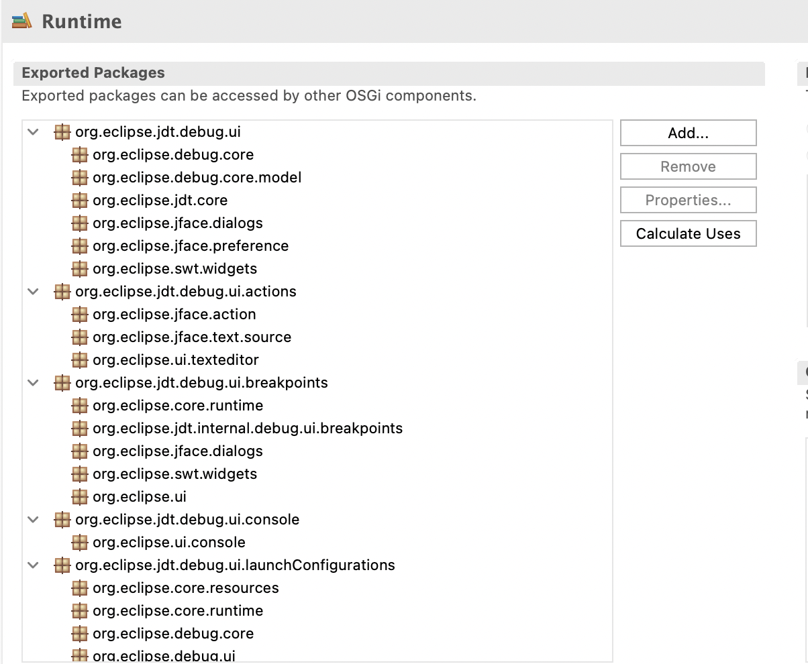

# Plug-in Development Environment - 4.42

A special thanks to everyone who [contributed to PDE](acknowledgements.md#plug-in-development-environment) in this release!

<!--
## Editors
-->

<!--
## API Tools
-->

<!--
---
## PDE Compiler 
-->

## Views and Dialogs

### Enhanced Runtime Exported Packages View
<!-- https://github.com/eclipse-pde/eclipse.pde/pull/2418 -->

Contributors

- [Elsa Zacharia](https://github.com/elsazac)

The Runtime Packages section has been redesigned to provide a better representation of package relationships.
Previously, the section displayed only exported packages in a table.
Now, when users click the `Calculate Uses` option, the packages referenced in each exported package’s `uses:` directive are displayed as child nodes, which can be expanded to explore package dependencies.
Users can also add new packages and remove individual `uses:` entries directly from the tree using the `Remove` option.
Any removal is automatically reflected in the manifest, eliminating the need for manual updates.
This enhancement makes it easier to explore package dependencies and manage runtime package declarations.

