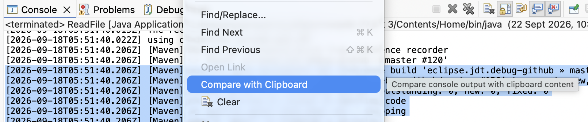
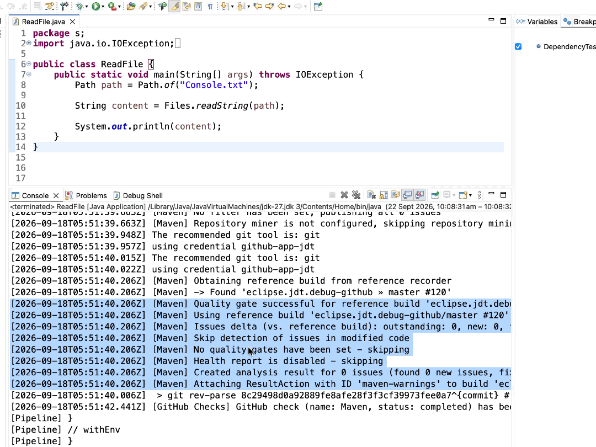
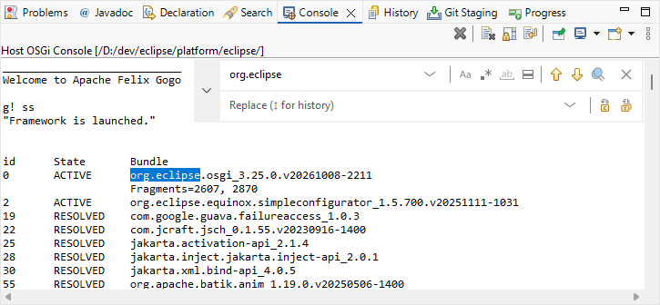
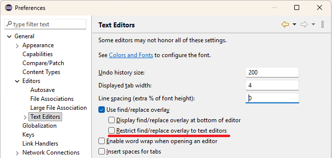

# Platform and Equinox - 4.42 

A special thanks to everyone who [contributed to Eclipse-Platform](acknowledgements.md#eclipse-platform) or [contributed to Equinox](acknowledgements.md#equinox) in this release!


## Views, Dialogs and Toolbar

### Compare Console Output with Clipboard

<details>
<summary>Contributors</summary>

- [Sougandh S](https://github.com/SougandhS)
</details>

The `Console` view now provides a `Compare with Clipboard` action to compare console output directly with text currently available in the clipboard using the `Compare Editor`.



This makes it easier to identify differences between console output and expected or reference content without manually copying the output into a separate editor or comparison tool.



The action is available when the `org.eclipse.compare` and` org.eclipse.compare.structuremergeviewer` bundles are present. 
If these optional dependencies are not available, the action is not provided.

### Find/Replace Overlay in the Console View
<!-- https://github.com/eclipse-platform/eclipse.platform.ui/pull/4509 -->
<details>
<summary>Contributors</summary>

- [Heiko Klare](https://github.com/HeikoKlare)
</details>

The find/replace overlay, which you know from text editors when pressing `Ctrl+F`,
is now also available in the `Console` view.
It is shown on top of the console output and behaves just like it does in an editor,
so you no longer have to fall back to the find/replace dialog to search console output.



You can restrict the overlay to text editors again with `Restrict find/replace overlay to text editors`
in `Preferences > General > Editors > Text Editors`.
The preference only serves as a fallback
and may be removed again in any future release once the generalized behavior has proven itself.



See [the related news](platform_isv.md#findreplace-overlay-available-in-any-part-adapting-to-itextviewer)
for how other views can offer the overlay.

---

<!--
---
## Text Editors
-->

<!--
---
## Preferences
-->

<!--
---
## Themes and Styling
-->

<!--
---
## Views, Dialogs and Toolbar
-->

## General Updates

### Minimum glibc Version Raised to 2.34 on Linux
<!-- https://github.com/eclipse-platform/eclipse.platform.releng.aggregator/issues/4080 -->
<details>
<summary>Contributors</summary>

- [Alexander Kurtakov](https://github.com/akurtakov)
</details>

The native parts of Eclipse and SWT on Linux are now built on Debian 12 instead of Debian 11 (EOL).
As a result, the Eclipse launcher and the SWT GTK 3 native libraries now require **glibc 2.34 or newer**, which the GTK 4 libraries already required.

In glibc 2.34, `dlopen` and `dlsym` moved from `libdl` into `libc`.
Binaries built against glibc 2.34 or newer link to these new symbol versions and can't be loaded on older systems.

This means Eclipse no longer runs on Linux distributions that ship an older glibc, for example:

- Red Hat Enterprise Linux 8 and derivatives such as AlmaLinux 8 and Rocky Linux 8 (glibc 2.28)
- Ubuntu 20.04 (glibc 2.31)
- Debian 11 (glibc 2.31)

Red Hat Enterprise Linux 9, Ubuntu 22.04, Debian 12 and newer releases are not affected.

On an unsupported system, the launcher fails to start with an error like:

```
./eclipse: /lib64/libc.so.6: version `GLIBC_2.34' not found (required by ./eclipse)
```
