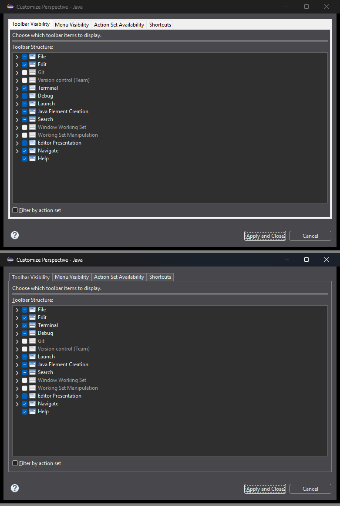
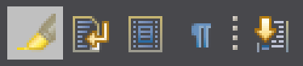
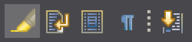

# Platform and Equinox API - 4.42

A special thanks to everyone who [contributed to Eclipse-Platform](acknowledgements.md#eclipse-platform) or [contributed to Equinox](acknowledgements.md#equinox) in this release!

---
## Platform Changes

### Find/Replace Overlay Available in Any Part Adapting to `ITextViewer`
<!-- https://github.com/eclipse-platform/eclipse.platform.ui/pull/4509 -->

Contributors

- [Heiko Klare](https://github.com/HeikoKlare)

The find/replace overlay is no longer restricted to text editors.
A part that supports find/replace by adapting to `IFindReplaceTarget`
now gets the overlay instead of the find/replace dialog
if it additionally adapts to `ITextViewer`,
i.e., if `getAdapter(ITextViewer.class)` returns the viewer presenting the part's text.
The overlay places itself on that viewer's text widget and takes its colors from it,
which is why the part itself decides whether the overlay can be hosted.
The `Console` view is the first part outside of text editors to provide that adapter.

Users can restrict the overlay to text editors again with `Restrict find/replace overlay to text editors`
in `Preferences > General > Editors > Text Editors`,
which serves as a fallback in case the overlay misbehaves in a part it has not been tried in yet.

---
## SWT Changes

### `TabFolder` Honors Background and Foreground Colors (Windows)
<!-- https://github.com/eclipse-platform/eclipse.platform.swt/pull/3785 -->

Contributors

- [Lars Vogel](https://github.com/vogella)

On Windows, `TabFolder.setBackground()` and `TabFolder.setForeground()` now take effect on the tabs.
This removes the white tabs and the bright frame from dialogs such as `Customize Perspective` in the dark theme.

As soon as you set either color on a `TabFolder`,
it paints its tab strip, tabs, pane and `SWT.BORDER` frame itself and gets a flat look instead of the native one.
This also applies if your application already sets colors that had no visible effect so far,
for example only a foreground, or a background matching the parent.
Remove these calls if you want to keep the native look,
which a `TabFolder` without its own colors retains.

The `Customize Perspective` dialog before (top) and after (bottom) the change:

### `ToolItem` Inherits Its Parent's Background (Windows)
<!-- https://github.com/eclipse-platform/eclipse.platform.swt/pull/3792 -->

Contributors

- [Lars Vogel](https://github.com/vogella)

On Windows, `ToolItem.getBackground()` now returns the color the item inherits from a parent with a background mode,
as set with `Composite.setBackgroundMode()`.
It used to return the system default,
which disagreed with `ToolBar.getBackground()` and with the behavior on GTK and macOS.
If your application reads this value on Windows, you now get the inherited color.

In the dark theme, this also improves selected toolbar buttons in the IDE.
Buttons such as `Toggle Mark Occurrences` now use a subtle color derived from the toolbar
instead of a bright block, so their icons remain easy to see.
Hot items follow the same color logic.

Colors set with `ToolItem.setBackground()` or `ToolBar.setBackground()` still take precedence,
and tool bars without an inherited background are not affected.

Before:

After:

